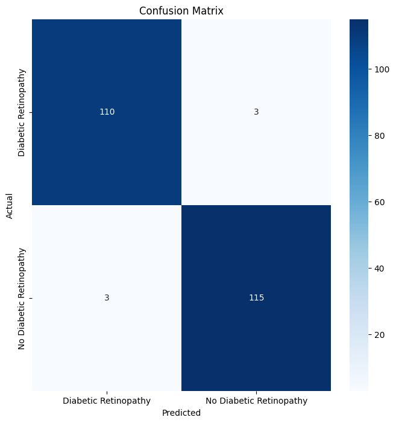

# Diabetic Retinopathy Detection (Transfer Learning)


[](https://www.kaggle.com/code/markkostantine/diabetic-retinopathy-using-transfer-learning)

Binary classification of retinal images as **diabetic retinopathy** or **no diabetic retinopathy**, using an ImageNet-pretrained **ResNet18** with a new 2-class head, built in PyTorch.

**97.4% accuracy on the test set** (225 of 231 images correct).

## Dataset
[Diagnosis of Diabetic Retinopathy](https://www.kaggle.com/search?q=Diagnosis+of+Diabetic+Retinopathy) on Kaggle, already split into `train`, `valid` and `test` folders with two classes (`DR`, `No_DR`). It is not included in this repo.

## Model and training
| | |
|---|---|
| Backbone | ResNet18 pretrained on ImageNet, final layer replaced with a 2-class head |
| Augmentation | Resize to 224 x 224, random horizontal and vertical flips, rotation up to 30 degrees, ImageNet normalisation |
| Optimiser | Adam (lr 1e-4) with `ReduceLROnPlateau` |
| Training | Batch size 64, 10 epochs, seed 42 |

## Results
Final-epoch validation accuracy was **97.7%** (validation loss 0.0012).

Test-set confusion matrix:



| | Predicted DR | Predicted No DR |
|---|---|---|
| **Actual DR** | 110 | 3 |
| **Actual No DR** | 3 | 115 |

The notebook also loads the saved weights and predicts a single image with class probabilities.

## Limitations and next steps
- Report precision, recall, specificity and ROC-AUC. For screening, missed cases (false negatives) matter most.
- Only two classes are used. Grading the severity of retinopathy is a harder multi-class problem.
- Add Grad-CAM to check that the model looks at the retina and not at image artefacts.
- Educational project. It is not a medical device and must not be used for diagnosis.

## Run it
```bash
git clone https://github.com/MarkKostantine/Diabetic-Retinopathy-Transfer-Learning.git
cd Diabetic-Retinopathy-Transfer-Learning
pip install -r requirements.txt
jupyter notebook diabetic-retinopathy-transfer-learning.ipynb
```
The notebook uses Kaggle paths (`/kaggle/input/diagnosis-of-diabetic-retinopathy/...`), so adjust them locally, or run the [original Kaggle notebook](https://www.kaggle.com/code/markkostantine/diabetic-retinopathy-using-transfer-learning).
